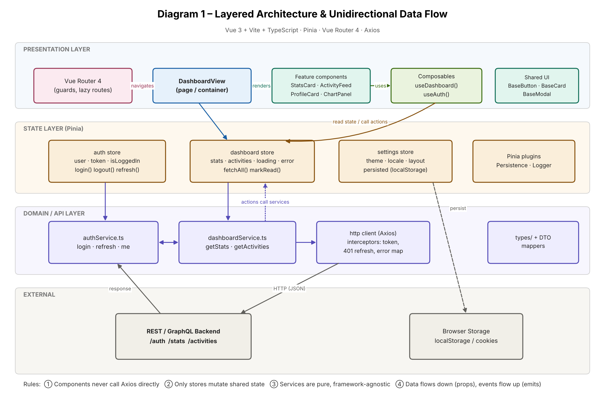
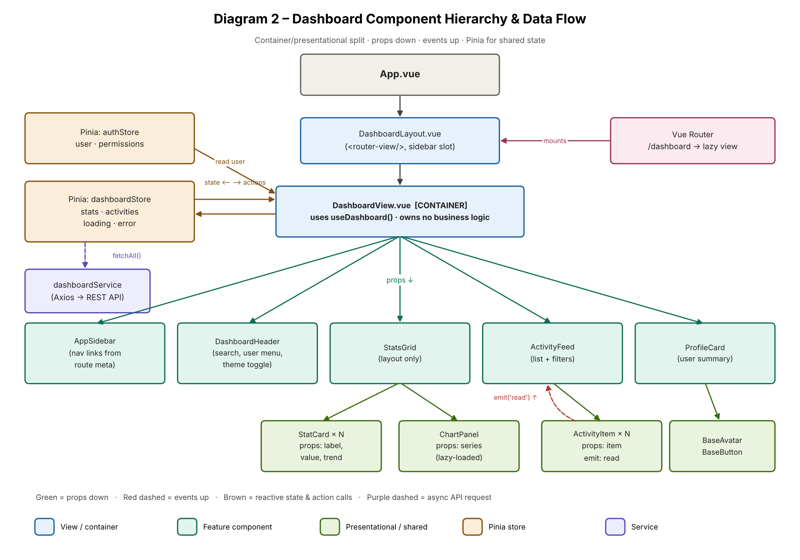
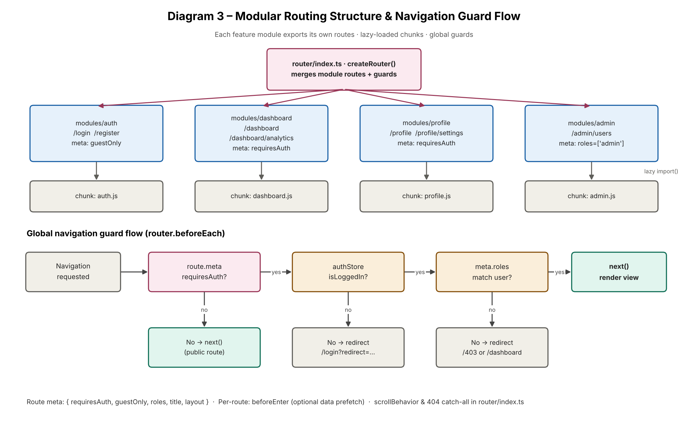

# Week 1 – Project Architecture & Planning
## Modular Vue 3 Application: "User Dashboard" Feature

| | |
|---|---|
| **Document type** | Architecture & planning document |
| **Stack** | Vue 3 (Composition API, `<script setup>`), TypeScript, Vite, Pinia, Vue Router 4, Axios |
| **Feature planned in detail** | User Dashboard (stats, activity feed, profile summary) |
| **Diagrams** | `diagrams/01_layered_architecture.png`, `02_component_hierarchy.png`, `03_routing_and_guards.png` (also combined in `architecture_diagrams.pdf`) |

---

## 1. Introduction and Goals

This document defines the architecture for a modular, scalable Vue 3 single-page application before any code is written. The User Dashboard is used as the worked example, but the structure is designed so every other feature (billing, admin, reports…) can be added the same way without touching existing modules.

**Architectural goals**

| Goal | What it means in practice |
|---|---|
| **Maintainability** | Small, single-purpose files; clear layer boundaries; predictable file locations |
| **Scalability** | New features are added as isolated modules; code is split per route; teams can work in parallel |
| **Testability** | Business logic lives outside components (stores, services, composables) so it can be unit-tested without a DOM |
| **Performance** | Route-level code splitting, lazy-loaded heavy components, cached/derived state |
| **Developer experience** | TypeScript everywhere, consistent conventions, lint/format/test tooling enforced in CI |

**Non-goals (Week 1):** server-side rendering, micro-frontends, and a design system library. They are noted in Section 11 as future considerations.

---

## 2. Research Summary – Best Practices Applied

| Topic | Findings from the Vue ecosystem | Decision |
|---|---|---|
| **API style** | Vue 3's Composition API groups logic by concern and enables reusable composables; Options API scatters one concern across `data/methods/computed`. | Composition API with `<script setup lang="ts">` |
| **State management** | Pinia is the officially recommended store (Vuex is in maintenance mode). It has first-class TypeScript support, no mutations, modular stores by default, and DevTools support. | **Pinia** |
| **Routing** | Vue Router 4 supports lazy-loaded routes, nested routes, `meta` fields, and navigation guards. | Modular route files merged in one router, lazy-loaded |
| **Project structure** | Large Vue projects scale better with **feature-based (domain) folders** than with type-based folders (`components/`, `views/`, `store/` at the root). | Feature modules + a small `shared/` kernel |
| **Component design** | Container/presentational split; props down, events up; avoid prop drilling by using stores or `provide/inject` sparingly. | Adopted (Section 6) |
| **Data fetching** | Keep HTTP out of components; centralise error handling and auth tokens in one client. | Service layer + Axios interceptors |
| **Tooling** | Vite for fast builds, Vitest for unit tests, Vue Test Utils, Cypress/Playwright for E2E, ESLint + Prettier. | Adopted (Section 9) |

Primary references: Vue 3 official guide (Composition API, Style Guide, Scaling Up), Pinia docs, Vue Router docs, Vite docs.

---

## 3. High-Level Architecture

See **Diagram 1 – Layered Architecture** (`diagrams/01_layered_architecture.png`).



The application is split into four layers. Dependencies point **downward only**; no layer may import from a layer above it.

| Layer | Responsibility | Contains | May depend on |
|---|---|---|---|
| **Presentation** | Rendering and user interaction | Views, feature components, shared UI, composables, router | State, Domain |
| **State (Pinia)** | Single source of truth for shared client state; orchestrates async actions | Stores, Pinia plugins | Domain |
| **Domain / API** | Talks to the outside world; maps API data to app models | Services, Axios client, DTO mappers, types | External only |
| **External** | Backend, browser storage | REST/GraphQL API, `localStorage`, cookies | – |

### Four architectural rules

1. **Components never call Axios directly.** They call composables or store actions.
2. **Only stores mutate shared state.** Components read state and dispatch actions.
3. **Services are framework-agnostic** (plain TypeScript, no Vue imports) so they can be reused and tested in isolation.
4. **Data flows down (props), events flow up (emits).** Cross-tree communication uses a store, not `$parent` or an event bus.

---

## 4. Folder Structure

A **feature-based** layout keeps everything about one business capability together.

```
src/
├── main.ts                     # app bootstrap (createApp, Pinia, Router)
├── App.vue                     # root component: <router-view/> + global providers
│
├── app/                        # app-wide wiring (not business logic)
│   ├── router/
│   │   ├── index.ts            # createRouter(), merges module routes
│   │   ├── guards.ts           # beforeEach: auth + role checks
│   │   └── types.ts            # RouteMeta augmentation
│   ├── store/
│   │   ├── index.ts            # createPinia() + plugins
│   │   └── plugins/            # persistence, logger
│   ├── layouts/                # DashboardLayout.vue, AuthLayout.vue
│   └── config/                 # env access, constants
│
├── modules/                    # ★ one folder per feature
│   ├── auth/
│   │   ├── components/         # LoginForm.vue, RegisterForm.vue
│   │   ├── views/              # LoginView.vue
│   │   ├── store/auth.store.ts
│   │   ├── services/auth.service.ts
│   │   ├── composables/useAuth.ts
│   │   ├── routes.ts           # exports RouteRecordRaw[]
│   │   ├── types.ts
│   │   └── index.ts            # public API of the module
│   │
│   ├── dashboard/
│   │   ├── components/
│   │   │   ├── StatCard.vue
│   │   │   ├── StatsGrid.vue
│   │   │   ├── ChartPanel.vue
│   │   │   ├── ActivityFeed.vue
│   │   │   ├── ActivityItem.vue
│   │   │   └── ProfileCard.vue
│   │   ├── views/DashboardView.vue          # container component
│   │   ├── store/dashboard.store.ts
│   │   ├── services/dashboard.service.ts
│   │   ├── composables/useDashboard.ts
│   │   ├── mappers/dashboard.mapper.ts      # API DTO → domain model
│   │   ├── routes.ts
│   │   ├── types.ts
│   │   └── __tests__/
│   │
│   ├── profile/                # same internal shape
│   └── admin/                  # same internal shape
│
├── shared/                     # reusable, feature-agnostic code
│   ├── components/             # BaseButton, BaseCard, BaseModal, BaseSpinner…
│   ├── composables/            # useDebounce, usePagination, useToast…
│   ├── services/http.ts        # Axios instance + interceptors
│   ├── utils/                  # formatDate, formatCurrency…
│   ├── types/                  # ApiResponse<T>, Pagination…
│   └── styles/                 # tokens, global CSS
│
├── assets/
└── tests/                      # e2e + shared test utilities
```

**Boundary rule:** a module may import from `shared/` and from another module's `index.ts` (its public API) only. It must **not** reach into another module's internal files. This is enforced with an ESLint rule (`eslint-plugin-boundaries` or `no-restricted-imports`).

**Naming conventions**

- Components: `PascalCase.vue`, multi-word (`StatCard.vue`) per the Vue style guide; base components prefixed `Base`.
- Composables: `useXxx.ts`. Stores: `xxx.store.ts`, store ids in camelCase (`useDashboardStore`).
- Services: `xxx.service.ts`. Types: `PascalCase`. Constants: `UPPER_SNAKE_CASE`.

---

## 5. Feature Design: User Dashboard

### 5.1 Requirements

| # | Requirement | Type |
|---|---|---|
| F1 | Show key stats (e.g. users, revenue, sessions, conversion) with trend indicators | Functional |
| F2 | Show a chart of a metric over time | Functional |
| F3 | Show a filterable activity feed; user can mark items as read | Functional |
| F4 | Show current user's profile summary | Functional |
| F5 | Only authenticated users can access | Functional |
| N1 | Initial dashboard load < 2 s on a typical 4G connection | Non-functional |
| N2 | Loading, empty and error states handled for every data section | Non-functional |
| N3 | Responsive (mobile → desktop), keyboard-accessible, WCAG AA contrast | Non-functional |

### 5.2 Component Hierarchy

See **Diagram 2 – Component Hierarchy & Data Flow** (`diagrams/02_component_hierarchy.png`).



```
App.vue
└── DashboardLayout.vue                (layout: sidebar slot + <router-view/>)
    └── DashboardView.vue              (CONTAINER – wires store ↔ UI)
        ├── AppSidebar.vue             (nav links generated from route meta)
        ├── DashboardHeader.vue        (search, user menu, theme toggle)
        ├── StatsGrid.vue
        │   ├── StatCard.vue × N       (props: label, value, trend)
        │   └── ChartPanel.vue         (props: series; lazy-loaded)
        ├── ActivityFeed.vue           (props: items, filter; emits: update:filter)
        │   └── ActivityItem.vue × N   (props: item; emits: read)
        └── ProfileCard.vue            (props: user)
            └── BaseAvatar / BaseButton
```

### 5.3 Component Responsibilities

| Component | Type | Props | Emits | Notes |
|---|---|---|---|---|
| `DashboardView` | Container | – | – | Calls `useDashboard()`, passes data down, handles loading/error display. No business logic. |
| `StatsGrid` | Presentational | `stats: Stat[]`, `loading` | – | Layout only (CSS grid). |
| `StatCard` | Presentational | `label`, `value`, `trend` | – | Pure; trivially unit-testable. |
| `ChartPanel` | Presentational | `series: Point[]` | `range-change` | Loaded with `defineAsyncComponent` (chart library is heavy). |
| `ActivityFeed` | Presentational | `items`, `filter` | `update:filter` | Uses `v-model:filter`. |
| `ActivityItem` | Presentational | `item: Activity` | `read(id)` | Emits event; does not mutate the item. |
| `ProfileCard` | Presentational | `user: User` | – | Read-only summary. |

### 5.4 Data Model (TypeScript)

```ts
// modules/dashboard/types.ts
export interface Stat {
  id: string;
  label: string;
  value: number;
  unit?: 'currency' | 'percent' | 'count';
  trend: { direction: 'up' | 'down' | 'flat'; percent: number };
}

export interface Activity {
  id: string;
  type: 'login' | 'purchase' | 'comment' | 'system';
  message: string;
  createdAt: string;      // ISO 8601
  read: boolean;
}

export interface Point { t: string; v: number }
```

### 5.5 State Design (Pinia)

```ts
// modules/dashboard/store/dashboard.store.ts
export const useDashboardStore = defineStore('dashboard', () => {
  // state
  const stats = ref<Stat[]>([]);
  const activities = ref<Activity[]>([]);
  const series = ref<Point[]>([]);
  const status = ref<'idle' | 'loading' | 'success' | 'error'>('idle');
  const error = ref<string | null>(null);
  const filter = ref<'all' | 'unread'>('all');

  // getters
  const visibleActivities = computed(() =>
    filter.value === 'unread' ? activities.value.filter(a => !a.read) : activities.value
  );
  const unreadCount = computed(() => activities.value.filter(a => !a.read).length);

  // actions
  async function fetchAll() {
    status.value = 'loading'; error.value = null;
    try {
      const [s, a, c] = await Promise.all([
        dashboardService.getStats(),
        dashboardService.getActivities(),
        dashboardService.getSeries('30d'),
      ]);
      stats.value = s; activities.value = a; series.value = c;
      status.value = 'success';
    } catch (e) {
      error.value = toMessage(e); status.value = 'error';
    }
  }

  async function markRead(id: string) {
    const item = activities.value.find(a => a.id === id);
    if (!item) return;
    item.read = true;                          // optimistic update
    try { await dashboardService.markRead(id); }
    catch { item.read = false; error.value = 'Could not update activity'; }  // rollback
  }

  return { stats, activities, series, status, error, filter,
           visibleActivities, unreadCount, fetchAll, markRead };
});
```

**Why a `status` enum instead of several booleans?** It makes impossible states unrepresentable (you cannot be `loading` and `error` simultaneously) and simplifies templates (`v-if="status === 'loading'"`).

### 5.6 Composable (bridge between UI and store)

```ts
// modules/dashboard/composables/useDashboard.ts
export function useDashboard() {
  const store = useDashboardStore();
  const { stats, series, visibleActivities, status, error, filter, unreadCount } = storeToRefs(store);
  onMounted(() => { if (store.status === 'idle') store.fetchAll(); });
  return { stats, series, visibleActivities, status, error, filter, unreadCount,
           refresh: store.fetchAll, markRead: store.markRead };
}
```

Components depend on `useDashboard()`, not on the store directly. If the state implementation changes (e.g., adding Vue Query), only this composable changes.

### 5.7 Service and HTTP Layer

```ts
// shared/services/http.ts
export const http = axios.create({ baseURL: import.meta.env.VITE_API_URL, timeout: 10_000 });

http.interceptors.request.use(cfg => {
  const token = useAuthStore().token;
  if (token) cfg.headers.Authorization = `Bearer ${token}`;
  return cfg;
});

http.interceptors.response.use(r => r, async err => {
  if (err.response?.status === 401) { /* try refresh once, else logout() */ }
  return Promise.reject(normalizeError(err));
});
```

```ts
// modules/dashboard/services/dashboard.service.ts
export const dashboardService = {
  getStats:      async () => (await http.get<StatDto[]>('/stats')).data.map(toStat),
  getActivities: async () => (await http.get<ActivityDto[]>('/activities')).data.map(toActivity),
  getSeries:     async (range: string) => (await http.get<Point[]>('/stats/series', { params: { range } })).data,
  markRead:      (id: string) => http.post(`/activities/${id}/read`),
};
```

Mappers (`toStat`, `toActivity`) isolate the UI from backend field names; a backend rename touches one file.

### 5.8 Data-Flow Walkthrough: "User marks an activity as read"

1. User clicks the button in **`ActivityItem`** → it emits `read(id)`.
2. **`ActivityFeed`** re-emits (or passes through) to **`DashboardView`**.
3. `DashboardView` calls `markRead(id)` from **`useDashboard()`**.
4. The **`dashboardStore.markRead`** action flips `read = true` immediately (optimistic update).
5. The action calls **`dashboardService.markRead`** → Axios → API.
6. On failure, the action rolls back and sets `error`.
7. Pinia's reactivity re-renders `ActivityFeed` and updates `unreadCount` in the header.

### 5.9 UI States (every data section)

| State | Behaviour |
|---|---|
| `loading` | Skeleton placeholders sized like the final content (prevents layout shift) |
| `success` with data | Normal render |
| `success` with no data | Empty-state message and call to action |
| `error` | Inline error with **Retry** button calling `refresh()` |

---

## 6. State Management Strategy

### 6.1 Classifying state

Not everything belongs in Pinia. Over-using global state is a common cause of tangled Vue apps.

| State type | Example | Where it lives |
|---|---|---|
| **Local UI state** | Dropdown open, input text | `ref()` inside the component |
| **Shared UI state** | Theme, sidebar collapsed | `settings` store (persisted) |
| **Shared domain state** | Current user, dashboard data | Feature Pinia store |
| **Server cache** | Lists fetched from API | Feature store now; consider TanStack Vue Query later |
| **URL state** | Filters, page, selected tab | Route query params (shareable, back-button friendly) |
| **Form state** | Login form | Local, with a validation lib (VeeValidate / Zod) |

### 6.2 Why Pinia over Vuex

| Criterion | Pinia | Vuex 4 |
|---|---|---|
| Official status | Recommended store for Vue 3 | Maintenance mode |
| Mutations | None – actions mutate state directly | Required (extra boilerplate) |
| TypeScript | Native inference | Needs workarounds |
| Modularity | Every store is its own module | Namespaced modules, more ceremony |
| Composition API | First-class (setup stores) | Awkward |
| DevTools | Time-travel, state editing | Supported |

### 6.3 Store design rules

- One store per domain concept (`auth`, `dashboard`, `settings`), not one store per page.
- Stores expose **state, getters, actions**; components never write to state directly.
- Stores may call **services**, and may read other stores *inside actions* (e.g., `useAuthStore()`), avoiding circular imports at module top level.
- Persist only what is needed (`settings`, auth token) via a small plugin; never persist server data blindly.
- Reset functions (`$reset` or custom) are provided so logout clears sensitive state.

---

## 7. Modular Routing

See **Diagram 3 – Routing Structure & Guard Flow** (`diagrams/03_routing_and_guards.png`).



### 7.1 Module-owned routes

Each module exports its own routes; the central router only composes them. A new feature never edits another feature's routing.

```ts
// modules/dashboard/routes.ts
export const dashboardRoutes: RouteRecordRaw[] = [
  {
    path: '/dashboard',
    component: () => import('@/app/layouts/DashboardLayout.vue'),
    meta: { requiresAuth: true, title: 'Dashboard' },
    children: [
      { path: '',          name: 'dashboard',
        component: () => import('./views/DashboardView.vue') },
      { path: 'analytics', name: 'dashboard-analytics',
        component: () => import('./views/AnalyticsView.vue'),
        meta: { title: 'Analytics' } },
    ],
  },
];
```

```ts
// app/router/index.ts
const routes = [
  ...authRoutes, ...dashboardRoutes, ...profileRoutes, ...adminRoutes,
  { path: '/', redirect: '/dashboard' },
  { path: '/:pathMatch(.*)*', name: 'not-found', component: () => import('@/shared/views/NotFound.vue') },
];
export const router = createRouter({ history: createWebHistory(), routes,
  scrollBehavior: (_to, _from, saved) => saved ?? { top: 0 } });
installGuards(router);
```

### 7.2 Route meta contract

```ts
declare module 'vue-router' {
  interface RouteMeta {
    requiresAuth?: boolean;
    guestOnly?: boolean;
    roles?: Array<'admin' | 'user'>;
    title?: string;
    layout?: 'dashboard' | 'auth' | 'blank';
  }
}
```

### 7.3 Navigation guard

```ts
// app/router/guards.ts
export function installGuards(router: Router) {
  router.beforeEach(async (to) => {
    const auth = useAuthStore();
    if (!auth.initialized) await auth.restoreSession();

    if (to.meta.requiresAuth && !auth.isLoggedIn)
      return { name: 'login', query: { redirect: to.fullPath } };
    if (to.meta.guestOnly && auth.isLoggedIn)
      return { name: 'dashboard' };
    if (to.meta.roles && !to.meta.roles.includes(auth.user!.role))
      return { name: 'forbidden' };
  });
  router.afterEach((to) => { document.title = to.meta.title ? `${to.meta.title} · MyApp` : 'MyApp'; });
}
```

Authorisation in the browser is a **UX convenience, not security**; the backend must enforce permissions on every request.

### 7.4 Performance via lazy loading

Every route component uses `() => import(...)`, so Vite emits one chunk per route. Users only download the dashboard code when they open the dashboard. Heavy widgets (`ChartPanel`) are further split with `defineAsyncComponent`.

---

## 8. Cross-Cutting Concerns

| Concern | Approach |
|---|---|
| **Authentication** | Access token in memory (Pinia) + refresh token in an `HttpOnly` cookie set by the backend; `restoreSession()` runs once at startup. Avoids XSS-exposed long-lived tokens in `localStorage`. |
| **Error handling** | Axios interceptor normalises errors into `AppError { code, message, status }`; stores expose `error`; a global `app.config.errorHandler` reports to Sentry. |
| **Loading UX** | Per-section `status`; skeletons; no global blocking spinner. |
| **Configuration** | `.env.development/.production` with `VITE_` variables, read only in `app/config`. |
| **Styling** | Scoped CSS + design tokens (CSS variables); optional utility framework (Tailwind). Dark mode via a `data-theme` attribute driven by the `settings` store. |
| **Accessibility** | Semantic HTML, `aria-live` for feed updates, focus management on route change, keyboard navigation, colour-contrast checks in CI (axe). |
| **i18n** | `vue-i18n` introduced when needed; strings already live in components so migration is mechanical. |
| **Security** | Vue escapes by default; avoid `v-html` with user content; CSP headers; dependency auditing (`npm audit`). |

---

## 9. Quality, Testing and Tooling

| Level | Tool | What is tested | Example |
|---|---|---|---|
| **Unit** | Vitest | Mappers, utils, services (mocked Axios) | `toStat()` converts DTO correctly |
| **Store** | Vitest + `@pinia/testing` | Actions, getters, rollback logic | `markRead` rolls back on API failure |
| **Component** | Vue Test Utils | Props → render, emit on click | `ActivityItem` emits `read` |
| **Integration** | Vitest + MSW | Container + store + mocked network | Dashboard shows error and retry |
| **E2E** | Playwright or Cypress | Critical paths | Login → dashboard → mark read |
| **Static** | ESLint, Prettier, `vue-tsc` | Style, types, import boundaries | CI blocks cross-module deep imports |

**CI pipeline (GitHub Actions):** install → lint → type-check → unit/component tests → build → E2E (on main). **Git workflow:** trunk-based with short-lived branches, Conventional Commits, PR review required.

**Testing pyramid target:** ~70 % unit/component, ~20 % integration, ~10 % E2E.

---

## 10. Design Decisions and Justification

### Scalability

| Decision | How it helps |
|---|---|
| Feature modules with public `index.ts` | New features are added by adding a folder; teams work in parallel with few merge conflicts; a module can later be extracted into a package or micro-frontend. |
| Module-owned routes | No central routing file that every developer edits; routes are discoverable next to their views. |
| Route-level lazy loading + async components | Bundle size grows with features but initial load does not. |
| Domain-split Pinia stores | Stores stay small; state ownership is clear; no mega-store. |
| Service layer + mappers | Backend changes (URLs, field names, even REST → GraphQL) are absorbed in one layer. |

### Maintainability

| Decision | How it helps |
|---|---|
| Layered architecture with one-way dependencies | Easy to reason about; changes have a predictable blast radius. |
| Container/presentational split | Presentational components are tiny, pure, reusable, and easy to test; only containers know about stores. |
| Composables as the UI↔state boundary | Logic reuse without mixins; swap state implementation without touching components. |
| TypeScript throughout, typed route meta and API models | Refactors are safe; invalid states caught at compile time; self-documenting contracts. |
| Naming conventions and enforced lint rules | New developers find things where they expect; reviews focus on logic, not style. |
| Status enums and uniform UI states | Consistent behaviour across features. |

### Trade-offs acknowledged

| Trade-off | Mitigation |
|---|---|
| More files and folders than a simple type-based layout | Scaffolding script/template (e.g. `plop`) generates a new module in seconds. |
| Indirection (component → composable → store → service) | Each layer is thin; the benefit appears as the app grows. For a tiny prototype this would be over-engineering. |
| Pinia is global state; misuse leads to hidden coupling | State classification table (6.1); URL and local state preferred when suitable. |
| Optimistic updates add rollback complexity | Limited to low-risk actions; covered by store tests. |

---

## 11. Feasibility, Risks and Roadmap

### 11.1 Practical feasibility

- Every technology chosen is mainstream, stable, and well documented; no experimental dependencies.
- A team of 2–4 developers can implement the dashboard module in roughly 2 weeks, including tests.
- The structure scales from a small team project to a larger codebase without a rewrite; the same layout is used by many production Vue 3 applications.

### 11.2 Risks

| Risk | Likelihood | Impact | Mitigation |
|---|---|---|---|
| Cross-module coupling creeps in | Medium | Medium | ESLint boundary rules, code review checklist |
| Over-engineering for current size | Medium | Low | Build only modules and stores that exist; resist premature abstraction |
| Token refresh race conditions | Medium | High | Single in-flight refresh promise in Axios interceptor; E2E test |
| Chart library inflates bundle | Medium | Medium | Lazy-load; evaluate lightweight alternatives; bundle analyser in CI |
| Backend contract changes | High | Medium | Mappers + typed DTOs + contract tests / OpenAPI-generated types |

### 11.3 Implementation roadmap (suggested)

| Phase | Deliverables |
|---|---|
| **1. Foundation** | Vite + TS scaffold, ESLint/Prettier, Vitest, folder structure, router + guards skeleton, Pinia setup, CI |
| **2. Auth module** | Login view, auth store/service, token handling, route guards |
| **3. Dashboard module** | Services/mappers, store, composable, components, UI states |
| **4. Hardening** | Tests (unit → E2E), accessibility pass, performance budget, error reporting |
| **5. Expansion** | Profile and admin modules using the same template |

### 11.4 Future considerations

TanStack Vue Query for server-state caching; Nuxt for SSR/SEO if needed; Storybook for component documentation; module federation if multiple teams need independent deployment.

---

## 12. Conclusion

The proposed architecture combines **feature-based modules**, a **strict layered structure**, **Pinia** for shared state, and **module-owned lazy-loaded routing**. The User Dashboard demonstrates how a feature flows from route → container → composable → store → service → API and back through reactive state to presentational components. Clear boundaries make the codebase easy to understand and test (maintainability), while isolated modules and code splitting allow the project to grow in features and team size without degrading structure or performance (scalability).

---

## Appendix A – Deliverables Checklist

| Requirement | Where addressed |
|---|---|
| Architecture document (Markdown) | This file |
| Visual diagram of component interactions, state flow, routing | `diagrams/` (PNG ×3 + combined PDF) |
| Research on best practices (state management, routing) | Section 2, 6, 7 |
| Feature outline with component hierarchy and data flow | Section 5 |
| Explanation of choices and impact on scalability/maintainability | Section 10 |
| Practical feasibility | Section 11 |

## Appendix B – Glossary

- **Container component:** a component that obtains data/state and passes it to presentational children.
- **Presentational component:** receives data only through props and communicates through emits; no knowledge of stores or APIs.
- **Composable:** a function using Vue's Composition API to encapsulate and reuse stateful logic.
- **DTO:** Data Transfer Object – the shape of data as sent by the API.
- **Code splitting:** dividing the build into chunks loaded on demand.
